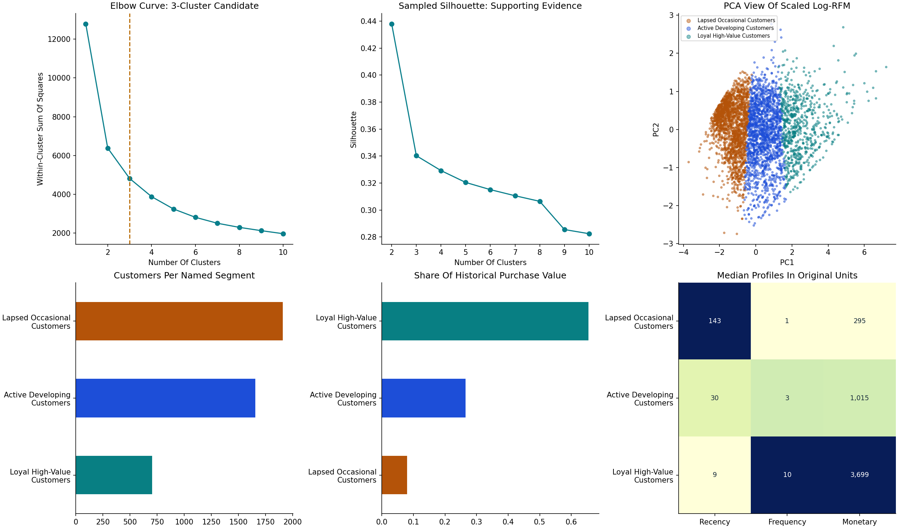

# RFM & Behavioral Customer Segmentation

**Joseph Ikogho · Data Science Portfolio Project 2**  
Public UCI transaction data · Manual pandas RFM · K-Means · Targeted campaign hypotheses  
Designed by Nova Agentic

## Business Question

**How should marketing engage a newly observed buyer, an active developing customer and a loyal high spender differently?** Generic campaigns ignore purchase history and waste relevance and budget. This project builds an intuitive RFM baseline, discovers compact RFM groups, and translates them into named audiences and a campaign playbook.

The output is an actionable segmentation workflow, **not a claim of increased conversion**. The dataset has no campaign exposure, controls, permissions or marketing conversion outcomes.

## Results At A Glance

| Evidence | Result |
|---|---:|
| Original transaction lines | 541,909 |
| Eligible positive purchase lines in the window | 378,508 |
| Identifiable customers | **4,264** |
| Distinct customer-invoice orders | 17,756 |
| Reference date / lookback | 2011-12-10 / 365 days |
| Manual RFM tiers | 6 |
| Elbow-selected K-Means candidate | **k=3** |
| Selected-k silhouette, sampled up to 2,000 customers | 0.340 |
| Minimum adjusted Rand index across five alternate seeds | 0.984 |
| Main versus 99th-percentile-capped RFM assignment ARI | 0.917 |
| Historical positive purchase value, GBP | £8,576,552.52 |

### Plain-English Cluster Profiles

| Segment | Customers | Median recency, days | Median orders | Median purchase value | Share of purchase value |
|---|---:|---:|---:|---:|---:|
| Lapsed occasional customers | 1,907 | 143 | 1 | £295.00 | 8.1% |
| Active developing customers | 1,654 | 30 | 3 | £1,014.70 | 26.5% |
| Loyal high-value customers | 703 | 9 | 10 | £3,699.26 | 65.5% |

The 703 loyal high-value customers contribute 65.5% of observed positive purchase value, while 1,907 lapsed occasional customers contribute 8.1%. These are historical shares—not future lifetime value or incremental campaign returns.



## Data Choice And Provenance

Selected **UCI Online Retail original**, dataset 352: [official source](https://archive.ics.uci.edu/dataset/352/online+retail), [DOI](https://doi.org/10.24432/C5BW33). Chen, D. (2015). Online Retail [Dataset]. UCI Machine Learning Repository. Licensed **CC BY 4.0**.

It includes invoice timestamps, customer IDs, products, quantities, prices and country for a UK non-store retailer, December 2010–December 2011. Many customers are wholesalers. Monetary units are **GBP**, not USD. The original workbook was serialized as `data/online_retail.csv.gz` with all 541,909 rows preserved. The workbook and CSV hashes are recorded in `data/source.json`.

The abbreviated dataset links in the brief are replaced with the exact dataset page. Online Retail II is also suitable but larger; Wholesale Customers lacks transaction dates and invoice histories needed for this exact RFM workflow. The project uses one consistent source, not an undocumented mix.

## Walkthrough: RFM Before Machine Learning

### 1. Freeze The Window And Clean The Records

Reference date is the day after the latest source date: **2011-12-10**. Analyze **[2010-12-10, 2011-12-10)**, a fixed 365-day lookback. The initial nine days of the source are outside this window.

Sequential exclusions are audited: 5,268 exact duplicate lines; 135,037 missing/invalid customer-ID rows; 8,872 cancellation lines; 40 nonpositive-price lines; and 14,184 remaining rows outside the window. No invalid dates/amounts, missing invoice/product IDs or additional nonpositive quantities remain at their respective steps. Counts are sequential, not independent overlapping tallies. Repeated identical lines could be legitimate without source line IDs; dropping them is an explicit assumption.

Do not impute customer IDs. Exclude cancellations and nonpositive quantities/prices from this **purchase-side** model. Monetary is positive purchase value, not refund-adjusted net revenue, margin or lifetime value. Postage/administrative product codes are not comprehensively removed; product-breadth/SKU features require business review before treating them as merchandise affinity.

### 2. Manually Calculate RFM In Pandas

- **Recency:** reference date minus latest eligible purchase date, in whole calendar days; lower is more recent.
- **Frequency:** number of distinct invoices per customer in the window; not rows, units or website visits.
- **Monetary:** sum of Quantity × UnitPrice across eligible lines, GBP.

The notebook shows explicit pandas groupby calculations and verifies them against `src/features.py` before clustering.

### 3. Score And Bucket The Intuitive Baseline

Population quintile cutoffs assign 1–5 scores. Recency is reversed; Frequency and Monetary are not. Equal values retain equal scores using left-side insertion, avoiding arbitrary rank-based splits of customers with the same invoice count. Ties mean tier sizes are not necessarily equal.

Ordered rules create six tiers: Champions, High value at risk of lapsing, Newly observed customers still exploring, Loyal repeat customers, Lapsed low-activity customers and Developing customers. First observed purchase age supports the “newly observed” tier; it is not first-ever customer tenure. Rules and cutoffs are explicit in `src/features.py` and `outputs/metrics.json`.

### 4. Run K-Means On Scaled RFM

Apply **log1p → StandardScaler → K-Means**, with seed 42 and n_init=20. Only Recency, Frequency and Monetary enter the model. Log transformation reduces skew; standardization stops GBP from dominating distance. No customers are capped or removed as outliers in the main fit.

Evaluate k=1…10. Normalize k and inertia, draw the chord between endpoint values, and choose the interior k with the largest perpendicular gap below that chord. This reproducible **elbow heuristic selects k=3**. The range 1…8 also selects three. This supports a practical candidate, not a theorem proving exactly three natural customer types.

Sampled silhouette is higher at k=2 than k=3; three gives a finer, interpretable split at the elbow. Report both rather than claiming every metric agrees. Five alternate-seed fits yield minimum ARI 0.984; 99th-percentile capping gives ARI 0.917 versus the main model. These inspect optimizer/outlier sensitivity, not future stability or marketing success. There is no supervised “accuracy” label.

### 5. Name, Describe And Activate The Groups

Plain-English names derive from original-unit median RFM profiles. Internal cluster IDs exist only for reproducibility. Profiles expose median days, order counts, spend, basket value, product breadth and repeat share.

Keep manual RFM tiers as a complementary lens: a high-value-at-risk customer can sit inside a broad cluster whose median spend is low. The `recommended_campaign` field overlays a personalized win-back hypothesis for the manual at-risk tier and second-purchase onboarding for newly observed tiers. Broad cluster membership never overrides these exceptions silently.

## Targeted Campaign Hypotheses

| Audience | Proposed engagement | What to measure |
|---|---|---|
| Loyal high-value customers | VIP recognition, early access and relevant cross-sell; test non-discount benefits | Incremental contribution per eligible customer |
| Active developing customers | Purchase-relevant nurture and repeat-order prompts | Incremental 30-day repeat-purchase rate |
| Lapsed occasional customers | Small, low-cost reactivation pilot | Incremental reactivation net of cost |
| Manual high-value-at-risk overlay | Personalized win-back/service support | Incremental reactivation and contribution |
| Manual newly observed overlay | Helpful onboarding and second-order test | Second-purchase rate within 30 days |

Randomize eligible, consented customers **within each segment** to campaign or control. Prespecify horizon, contribution metric, contact/offer costs, baseline conversion, minimum detectable effect and sample size. Account for multiple segment comparisons; record treatment exposure and redemption. Segments are planning tools, not evidence that a particular customer wants an offer.

## Behavioral Extension And Unavailable Lenses

Observed transaction lenses include average order value, units per order, product breadth, repeat buying, first observed purchase age, top purchased SKU and modal country. They **profile** RFM clusters; they do not secretly expand K-Means features. A top SKU is a purchase fact, not a validated interest profile. Basket size is not household wealth, especially with wholesalers present.

With authorized broader data, evaluate product taxonomy, opt-in browsing/engagement, household composition or lifecycle lenses. Do not fabricate household attributes or infer demographics from purchases. Check incremental usefulness, consent and fairness before expanding a feature set.

## Run On Windows

Use your installed **Python 3.12**. Extract the project and open PowerShell in `rfm-customer-segmentation`.

```powershell
py -3.12 -m venv .venv312
.\.venv312\Scripts\python.exe -m pip install -r requirements.txt
.\.venv312\Scripts\python.exe -m streamlit run app.py
```

Activation is unnecessary. Alternatively, double-click `SETUP_WINDOWS.bat` once, then `START_DASHBOARD.bat`. The browser opens at `http://localhost:8501` unless another app occupies that port. Keep the terminal open. Native light theme is supplied; native dark mode remains coherent because styling does not force background/text colors.

For a no-install overview, open `PORTFOLIO_OVERVIEW.html`. The fitted model, data, outputs and executed notebook are bundled; you do not need to retrain to use the dashboard.

### Reproduce Or Assign New Customer RFM

```bash
python -m src.segment
python -m src.predict data/example_rfm.csv outputs/new_assignments.csv
python -m pytest -q
# Optional: Re-Download The Source And Rebuild The Compressed CSV:
python -m src.download_data
```

Run these using the project's Python environment. On Windows without activation, replace `python` with `.\.venv312\Scripts\python.exe`. Reproduction uses bundled data and needs no download. New RFM uploads must use the same window and business definitions; another store/currency/history is not automatically comparable. Only load the trusted project joblib model.

## Repository Guide

| Path | Purpose |
|---|---|
| `src/features.py` | Cleaning, explicit pandas RFM, tied-score baseline and validation |
| `src/segment.py` | Transformation, elbow analysis, clustering, names, diagnostics and exports |
| `src/predict.py` | Frozen-model RFM CSV assignment |
| `src/download_data.py` | Re-download original workbook and preserve rows as compressed CSV |
| `app.py`, `.streamlit/config.toml` | Readable dashboard, filters, campaign playbook and audience export |
| `notebooks/02_rfm_behavioral_segmentation.ipynb` | Executed analysis and justified decisions |
| `outputs/customer_segments.csv` | Customer RFM, scores, tiers, named groups and campaign overlay |
| `outputs/segment_profiles.csv` | Original-unit profiles and purchase-value shares |
| `outputs/elbow_diagnostics.csv` | Inertia, sampled silhouette and chord distances |
| `outputs/baseline_vs_clusters.csv` | Comparison with manual tiers |
| `outputs/campaign_playbook.csv` | Actions, KPIs and guardrails |
| `outputs/cleaning_audit.csv`, `seed_stability.csv` | Quality and robustness evidence |
| `CASE_STUDY.md`, `SEGMENT_PLAYBOOK.md` | Recruiter narrative and stakeholder campaign plan |
| `DATA_DICTIONARY.md`, `MODEL_CARD.md` | Definitions, provenance, intended use and limitations |
| `REQUIREMENTS_AUDIT.md`, `VALIDATION.md` | Brief mapping and checks actually performed |
| `GITHUB_GUIDE.md`, `.github/workflows/` | Publication instructions and automated checks |

## Limits And Next Evidence

Historical dataset, incomplete customer identities, purchase-only exclusions, duplicate assumptions, wholesale activity and seasonality can shape results. K-Means prefers compact Euclidean groups and can miss non-spherical structure. Log scaling and k-range affect the elbow. All customers are used for descriptive clustering; no held-out supervised accuracy is claimed. Segments may drift across dates; temporal validation is a future task. Customer IDs are public pseudonymous identifiers, not ready-to-contact identities. Campaign conversion and profit improvements require a randomized pilot.

Code: MIT (`LICENSE`). Dataset and adapted exports: UCI Online Retail, CC BY 4.0 (`DATA_LICENSE.md`, `NOTICE`). No private employer data, fabricated marketing outcomes or redistributed screenshots are included.


## Dashboard Presentation Update

Version 1.1 leads with a selected-audience concentration insight and three campaign cards. Metrics, profiles, comparisons, scatterplots and exports use the same filters. Cards provide View Audience and Export This Audience actions. Full-population profiles and model diagnostics remain explicitly separate.

The overview uses a stable segment palette (teal for loyal high-value, blue for active developing, amber for lapsed occasional), horizontal count bars, paired customer/value shares, human-readable table headings and percentage/GBP formatting. The purchase-value scatter defaults to a logarithmic scale, offers linear scale and a display-only 99% zoom, and includes customer-level hover details. Hidden chart outliers remain in all metrics, models and exports.

Headings and subheadings, including chart titles and publication/document headings, use Title Case while preserving RFM, CSV, GBP, SKU and other acronyms. Raw CSV schema and fitted assignments are unchanged. Default font size is a restrained 16 px; the supplied screenshot had been zoomed out and was not treated as normal-size typography evidence. No model retraining is required. See DASHBOARD_UPDATE.md for installation.
